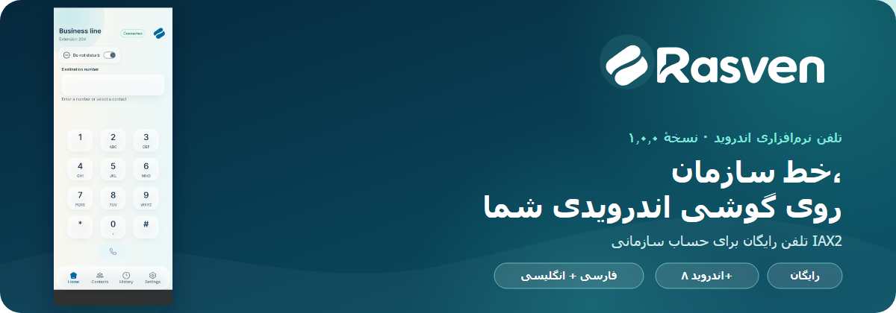
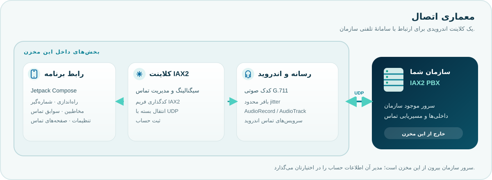

<p align="center">
  
</p>
<p dir="rtl" align="right"><sub>بنر از صفحهٔ خانهٔ خود Rasven استفاده می‌کند؛ وضعیت اتصال و داخلیِ دیده‌شده نمونه‌اند.</sub></p>

<h1 align="center">Rasven برای اندروید</h1>

<p align="center">
  <a href="README.md">English</a> · <a href="#download">دریافت</a> · <a href="#features">امکانات</a> · <a href="#get-started">شروع کار</a> · <a href="#architecture">معماری</a> · <a href="#support-rasven">حمایت مالی</a>
</p>

<p dir="rtl" align="right"><strong>خط سازمان، همراه گوشی اندرویدی شما.</strong><br>تلفن نرم‌افزاری رایگان برای حساب موجود در PBX سازمانی سازگار با <bdi dir="ltr">IAX2</bdi>.</p>

<p dir="rtl" align="right">Rasven کمک می‌کند از حساب تلفنی موجود سازمان روی گوشی اندرویدی استفاده کنید. این برنامه سرویس تلفنی، سامانهٔ <bdi dir="ltr">PBX</bdi> یا حساب آن را ارائه نمی‌دهد.</p>

<h2 id="download" dir="rtl" align="right">دریافت</h2>

<p dir="rtl" align="center"><a href="https://github.com/hellodarnio/rasven/releases/tag/v1.0.0"><strong>↓ دریافت APK نسخهٔ Rasven v1.0.0</strong></a></p>

<p dir="rtl" align="right">فایل <bdi dir="ltr">APK</bdi> در <a href="https://github.com/hellodarnio/rasven/releases/tag/v1.0.0">صفحهٔ Release گیت‌هاب</a> قرار دارد. نسخهٔ اول Rasven در بازارهای اپلیکیشن هم موجود است.</p>

<blockquote dir="rtl"><strong>تطبیق بسته:</strong> بستهٔ نسخهٔ ۱٫۰٫۰ که در بازار و روی یک دستگاه در ۲۰۲۶-۱۰-۲۹ بررسی شد، از نظر <bdi dir="ltr">SHA-256</bdi> با فایل همین Release یکسان بود: <code dir="ltr">07918398b40f32dc3e076e4d74407c078c66155d0dd92922ab4286a2855d3965</code>. این بررسی فقط همان بسته را تأیید می‌کند؛ بسته‌های بازارهای دیگر مقایسه نشده‌اند.</blockquote>

<h2 id="features" dir="rtl" align="right">با Rasven چه می‌توانید بکنید؟</h2>

<table dir="rtl">
  <tr>
    <td width="50%"><h3 dir="rtl" align="center">📞 تماس با خط سازمان</h3><p dir="rtl" align="center">تماس ورودی و خروجی با حساب <bdi dir="ltr">IAX2</bdi> سازمان.</p></td>
    <td width="50%"><h3 dir="rtl" align="center">🎛️ کنترل هنگام تماس</h3><p dir="rtl" align="center">بی‌صداکردن، بلندگو، انتظار و صفحه‌کلید تماس.</p></td>
  </tr>
  <tr>
    <td width="50%"><h3 dir="rtl" align="center">👥 ابزارهای روزمرهٔ تلفن</h3><p dir="rtl" align="center">دسترسی سریع به مخاطبین، سوابق تماس و تنظیمات تماس.</p></td>
    <td width="50%"><h3 dir="rtl" align="center">🌐 فارسی و انگلیسی</h3><p dir="rtl" align="center">استفاده از برنامه به هر یک از این دو زبان.</p></td>
  </tr>
</table>

<p dir="rtl" align="right">این فهرست امکاناتی را نشان می‌دهد که در سورس فعلی وجود دارند و تأیید سازگاری با همهٔ <bdi dir="ltr">PBX</bdi>ها یا دستگاه‌های اندرویدی نیست.</p>

<h2 id="get-started" dir="rtl" align="right">شروع کار در سه مرحله</h2>

<ol dir="rtl" align="right">
  <li>آدرس سرور، پورت، داخلی یا نام کاربری و رمز را از مدیر <bdi dir="ltr">PBX</bdi> سازمان بگیرید.</li>
  <li>Rasven را از بازار اپلیکیشن یا Release گیت‌هاب نصب کنید.</li>
  <li>حساب را اضافه کنید و برای تماس، مجوز میکروفن و اعلان را بدهید. دسترسی مخاطبین اختیاری است.</li>
</ol>

<h2 dir="rtl" align="right">نمایی از برنامه</h2>

<p align="center">
  
</p>
<p dir="rtl" align="right"><sub>این صفحهٔ خانهٔ واقعی برنامه است. وضعیت اتصال و داخلیِ نمایش‌داده‌شده نمونه‌اند و اتصال زنده به PBX را نشان نمی‌دهند.</sub></p>

<h2 id="architecture" dir="rtl" align="right">معماری</h2>

<p dir="rtl" align="right">Rasven یک کلاینت اندرویدی با کد سیگنالینگ <bdi dir="ltr">IAX2</bdi> و انتقال <bdi dir="ltr">UDP</bdi> داخلی است. صدای تماس از موتور رسانهٔ <bdi dir="ltr">G.711</bdi> برنامه و رابط‌های صوتی اندروید عبور می‌کند. <bdi dir="ltr">PBX</bdi> سروری موجود و تحت مدیریت سازمان است و در این مخزن قرار ندارد.</p>

<p align="center">
  
</p>

<p dir="rtl" align="right">برنامه برای اتصال به <bdi dir="ltr">PBX</bdi> به حساب معتبر و دسترسی شبکه نیاز دارد. آدرس سرور، پورت، داخلی یا نام کاربری و رمز را از مدیر سامانه بگیرید.</p>

<h2 dir="rtl" align="right">پیش‌نیازها</h2>

<ul dir="rtl" align="right">
  <li>اندروید ۸٫۰ (<bdi dir="ltr">API 26</bdi>) یا جدیدتر</li>
  <li>حساب کاربری در <bdi dir="ltr">PBX</bdi> سازمانی سازگار با <bdi dir="ltr">IAX2</bdi></li>
  <li>دسترسی شبکه به همان سرور</li>
  <li>مجوز میکروفن و اعلان برای تماس؛ دسترسی مخاطبین اختیاری است</li>
</ul>

<h2 dir="rtl" align="right">ساخت از سورس</h2>

<p dir="rtl" align="right">یک <bdi dir="ltr">JDK</bdi> سازگار و <bdi dir="ltr">Android SDK</bdi> نصب کنید، سپس مخزن را در Android Studio باز کنید یا از ریشهٔ پروژه <bdi dir="ltr">Gradle Wrapper</bdi> را اجرا کنید.</p>

<p dir="rtl" align="right"><strong>Windows PowerShell</strong></p>
```powershell
.\gradlew.bat :app:assembleDebug
```

<p dir="rtl" align="right"><strong>Linux یا macOS</strong></p>
```sh
./gradlew :app:assembleDebug
```

<p dir="rtl" align="right">فایل آزمایشی در <code dir="ltr">app/build/outputs/apk/debug/</code> قرار می‌گیرد. این فایل برای توسعه و ارزیابی است و نسخهٔ عمومیِ امضاشده محسوب نمی‌شود. ساخت نسخهٔ انتشار به شناسهٔ تأییدشدهٔ برنامه و اطلاعات امضا نیاز دارد؛ این مقادیر را بیرون از مخزن نگه دارید و فایل کلید یا رمزها را commit نکنید.</p>

<h2 dir="rtl" align="right">وضعیت اعتبارسنجی</h2>

<p dir="rtl" align="right">گزارش handoff مورخ ۲۰۲۶-۱۰-۲۳ برای این snapshot سورس، <strong>۳۳۲ آزمون موفق JVM</strong> و اجرای هدفمند روی دستگاه اندرویدی با نتیجهٔ <strong>۸ از ۸</strong> را ثبت کرده است. این بررسی‌ها پیش از تغییر اخیر تنظیمات امضا اجرا شده‌اند. یک اجرای جداگانه از مجموعهٔ کامل دستگاه <strong>۱۹۰ از ۱۹۵</strong> بود و پنج خطا داشت؛ بنابراین آن مجموعه سبز نبود. در handoff ساخت APK تازه‌ای پس از تغییر تنظیم امضا ثبت نشده است.</p>

<p dir="rtl" align="right">سازگاری زنده با PBX، انتقال مشاوره‌ای تماس و رفتار طولانی‌مدت در پس‌زمینه و Doze برای این snapshot هنوز تأیید نشده‌اند. نتیجه‌های آزمون تاریخی هم APK فعلی بازار را تأیید نمی‌کنند.</p>

<h2 id="support-rasven" dir="rtl" align="right">حمایت مالی</h2>

<p dir="rtl" align="right">استفاده از Rasven رایگان است. اگر برای کار سازمانتان مفید است، می‌توانید با <bdi dir="ltr">USDT</bdi> از ادامهٔ توسعهٔ آن حمایت کنید. حمایت کاملاً اختیاری است.</p>

<table dir="rtl">
  <tr><th>💛 <bdi dir="ltr">USDT</bdi> · <bdi dir="ltr">BNB Smart Chain (BEP-20)</bdi></th><th>🔺 <bdi dir="ltr">USDT</bdi> · <bdi dir="ltr">TRON (TRC-20)</bdi></th></tr>
  <tr>
    <td align="center"></td>
    <td align="center"></td>
  </tr>
  <tr>
    <td align="center"><code dir="ltr">0x2548E3A6dECac1FFfb0d02175d165B914CF04D40</code></td>
    <td align="center"><code dir="ltr">TDWVLgeWp21hkPV4zgRJzMTB28nzcyuGck</code></td>
  </tr>
</table>

<p dir="rtl" align="right">هر QR فقط آدرس کیف پول را کدگذاری می‌کند و توکن یا شبکه را برای کیف پول انتخاب نمی‌کند. پیش از ارسال، <bdi dir="ltr">USDT</bdi> و شبکهٔ دقیق بالا را در کیف پولتان بررسی کنید. انتقال روی شبکه‌ای دیگر ممکن است قابل‌بازیابی نباشد.</p>

<h2 dir="rtl" align="right">وضعیت پروژه و مجوز</h2>

<p dir="rtl" align="right">مخزن سورس عمومی است. <strong>هنوز مجوزی برای کل پروژه اضافه نشده</strong>؛ بنابراین سورس قابل‌مشاهده است، اما با مجوز متن‌باز منتشر نشده. پیش از استفادهٔ عمومی مجدد از کد یا دعوت عمومی به مشارکت، باید مجوز انتخاب و اضافه شود.</p>

<p dir="rtl" align="right">نگه‌داری پروژه: <strong>Darnio Studio</strong>.</p>
