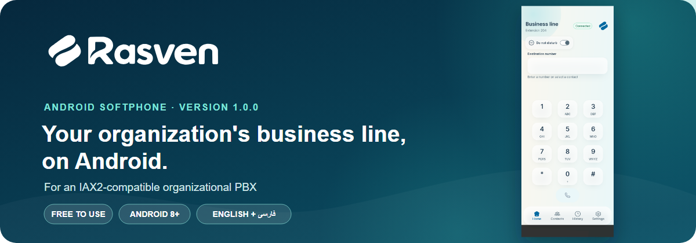
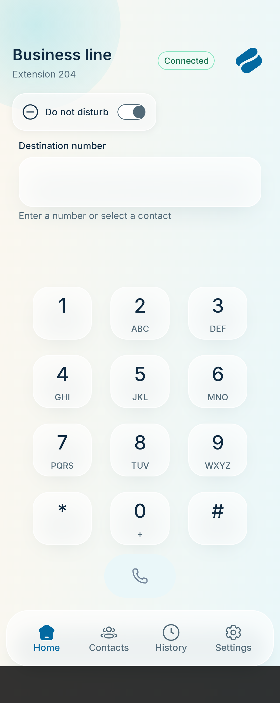
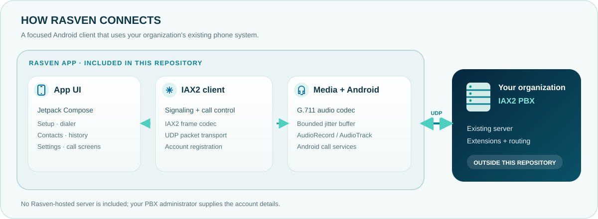

<p align="center">
  
</p>
<p align="center"><sub>The banner shows the actual Rasven home screen. Its connection indicator and extension are sample values.</sub></p>

<h1 align="center">Rasven for Android</h1>

<p align="center">
  <a href="README.fa.md">فارسی</a> · <a href="#download">Download</a> · <a href="#architecture">Architecture</a> · <a href="#support-rasven">Support Rasven</a>
</p>

Rasven is a free Android softphone for people who already have an account on an **IAX2-compatible organizational PBX**. It brings the organization's business line to an Android phone; it does not provide phone service, a PBX, or PBX accounts.

## Download

<p align="center"><a href="https://github.com/hellodarnio/rasven/releases/tag/v1.0.0"><strong>Get the Rasven v1.0.0 APK</strong></a></p>

The APK is attached to the [GitHub Release](https://github.com/hellodarnio/rasven/releases/tag/v1.0.0). **This repository is private**, so GitHub requires repository access to download it. Rasven v1 is also available through app markets.

> **Version note:** the market package has not been matched to this exact source snapshot or signing certificate. Installing this APK may not update a market-installed copy.

## At a glance

| | |
|---|---|
| 📞 **Business-line calling** | IAX2 account setup and incoming/outgoing call flows |
| 🎛️ **In-call controls** | Mute, speaker, hold, and keypad controls are included in the app |
| 👥 **Useful phone tools** | Contacts, call history, and call settings |
| 🌐 **Two languages** | English by default, with Persian available |

The list describes the current source. It is not a certification of compatibility with every PBX or Android device.

## See the app

<p align="center">
  
</p>
<p align="center"><sub>Home dialer UI from the source project's device evidence. Its connected indicator and extension are sample state, not a live PBX connection.</sub></p>

## Architecture

Rasven is an Android client with its own IAX2 signaling and UDP transport code. Call audio passes through the app's G.711 media engine and Android audio APIs. The PBX is an existing server managed by the organization; it is outside this repository.

<p align="center">
  
</p>

The app needs an IAX2 account and network access to that PBX. Ask the PBX administrator for the server address, port, extension or username, and password.

## Requirements

- Android 8.0 (API 26) or newer
- An account from an IAX2-compatible organizational PBX
- Network access to that PBX
- Microphone and notification permissions for calling; contacts access is optional

## Build from source

Install a compatible JDK and Android SDK, then open the repository in Android Studio or use the Gradle Wrapper from the project root.

**Windows PowerShell**

```powershell
.\gradlew.bat :app:assembleDebug
```

**Linux or macOS**

```sh
./gradlew :app:assembleDebug
```

The debug APK is written to `app/build/outputs/apk/debug/`. It is for development and evaluation, not a signed public release. A release build also requires the approved production application ID and signing credentials; keep those values outside this repository and never commit a keystore or passwords.

## Validation status

The source handoff dated 2026-10-23 reported **332 passing JVM unit tests** and a targeted Android device run of **8/8**. These checks predate the latest signing configuration change. A separate full device run reported **190/195**, with five failures, so that suite was not green. The handoff records no fresh APK build after the signing change.

Live interoperability with a PBX, attended transfer, and extended background/Doze behavior remain unverified for this source snapshot. Historical test results do not verify the APK currently distributed through app markets.

## Support Rasven

Rasven is free to use. Cryptocurrency support is optional and accepted in **USDT only** at the two addresses below. Each QR code contains only its wallet address; it does not select a token or network for you.

| 🟢 **USDT · BNB Smart Chain (BEP-20)** | 🔺 **USDT · TRON (TRC-20)** |
|---|---|
|  |  |
| `0x2548E3A6dECac1FFfb0d02175d165B914CF04D40` | `TDWVLgeWp21hkPV4zgRJzMTB28nzcyuGck` |

Before sending, confirm **USDT** and the exact network shown above in your wallet. A transfer on a different network may not be recoverable.

## Project status and license

The source repository is private today. **No project license has been added yet**, so the code is not yet released under an open-source license. A license must be selected before public reuse or public contribution can be invited.

Maintained by **Darnio Studio**.
